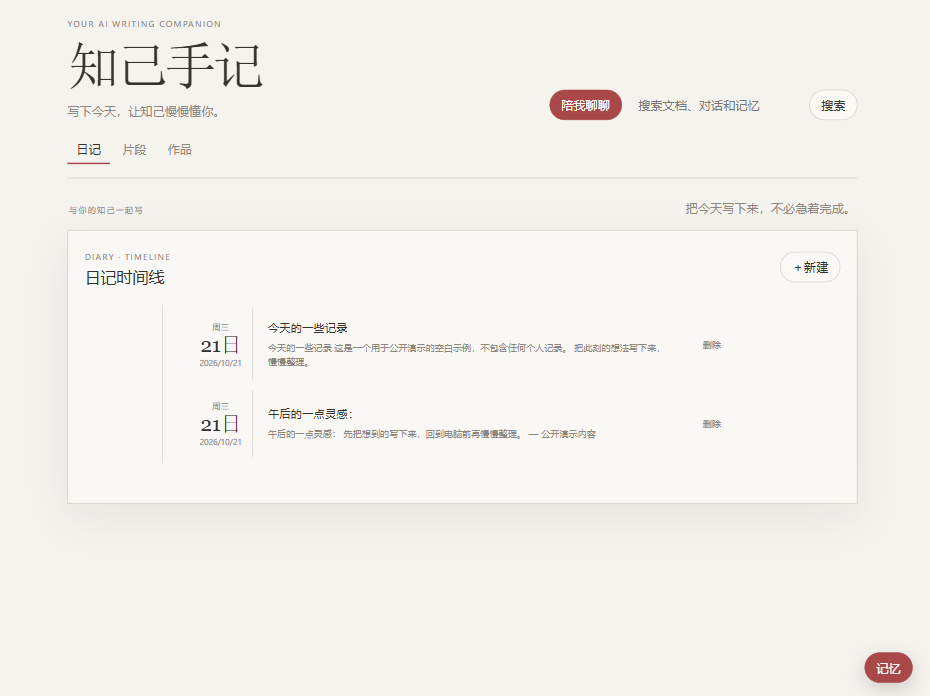
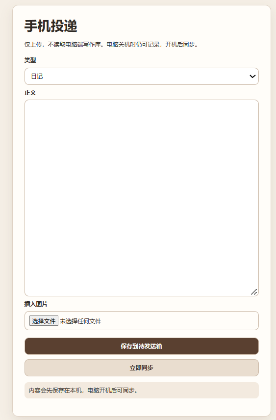

# 知己手记

把日记写下来，也让一位真正了解你的私人朋友陪你慢慢走下去。

知己手记首先是一个运行在你自己电脑上的本地优先写作工具：你可以记录日记、收集灵感、整理作品。配置可选的 AI 后，它会从你允许使用的日志和对话中记住你的偏好、经历与重要近况；因此，你不必每次从头解释，也可以围绕真实的生活和想法与它交流、梳理思路，或像和朋友一样聊天。

这一切以你的资料库为基础。正文、附件、搜索索引和备份都保存在自己选择的本地目录中；你可以定义这位朋友的角色，也可以随时锁定不希望它阅读的文稿。即使没有网络、没有配置模型，写作和整理也不会停下来。

## 界面预览

### 电脑端



### 手机端



## 它可以做什么

- 配置 AI 后获得一位可定义角色的私人朋友：陪聊、回顾、梳理想法，并从你允许处理的内容中形成长期记忆。
- 用 Markdown 保存日记、片段和作品，内容不被锁在云端服务中。
- 在本机全文搜索已有内容，并支持附件、导出和恢复。
- 自动创建每日备份；恢复时会创建副本，不会覆盖正在使用的资料库。
- 可锁定不希望用于 AI 的文稿；锁定内容仍可本地搜索，但不会进入新的 AI 上下文。
- 让手机在同一可信 Wi-Fi 下创建内容。手机只能投递新内容，不能读取或修改电脑上已有文稿；离线时会先保存在手机，恢复连接后再同步。

## AI 功能（可选）

配置兼容 OpenAI API 的模型后，它不只是一次性的写作工具，也可以成为一位陪你长期记录与思考的**私人朋友**。你可以先为这位朋友定义角色和相处方式：温柔倾听、帮你想清楚、提出不同看法，或只是安静地陪你聊天。

- **慢慢了解你**：它会从你允许处理的日志、片段和对话中提取偏好、经历和重要背景，整理成可长期使用的记忆。
- **围绕真实生活交流**：因为它能够读到你主动允许使用的写作内容，后续不必每次从头解释，便可以围绕你的近况、经历和想法继续交流、梳理思路，或像朋友一样聊天。
- **由你掌握边界**：你随时可以锁定文稿；被锁定的内容不会进入新的 AI 对话、问候或记忆提取上下文。图片输入也只会在你主动开启后使用。

AI 不是使用产品的前提。未配置 API、模型不可用或网络中断时，本地写作、搜索、附件、导出、备份和恢复照常可用；待处理的 AI 任务会保留在本机队列中，待服务恢复后再继续。API Key 仅保存在 Windows 凭据管理器中，不写入正文、数据库、日志或普通配置文件。


## 隐私与边界

这是一个单人、本地优先的工具：资料库由你指定，程序不会把已有文稿公开到网络。开启手机投递时，请仅在可信的私有 Wi-Fi 使用 `--lan` 模式，不要把服务暴露到公网。

AI 功能完全可选。未配置 API 或网络不可用时，写作、搜索、附件、导出、备份和恢复仍然可用。

## 快速开始

需要 Windows 和 Python 3.12 或更新版本。

```powershell
python -m venv .venv
.\.venv\Scripts\Activate.ps1
python -m pip install -e ".[dev]"
$env:WRITING_LIBRARY_ROOT = "D:\\WritingLibrary"
python -m writing_companion.cli serve --library $env:WRITING_LIBRARY_ROOT
```

打开浏览器访问 `http://127.0.0.1:8765` 即可开始使用。

完整的资料库结构、备份恢复、API Key、手机投递与常见操作，请阅读 [使用指南](docs/使用指南.md)。

## 开源许可

本项目以 [MIT License](LICENSE) 发布。
